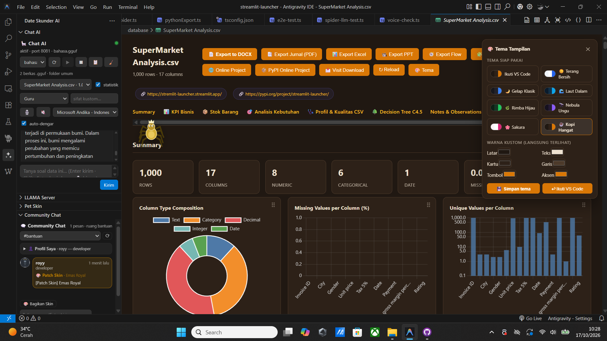
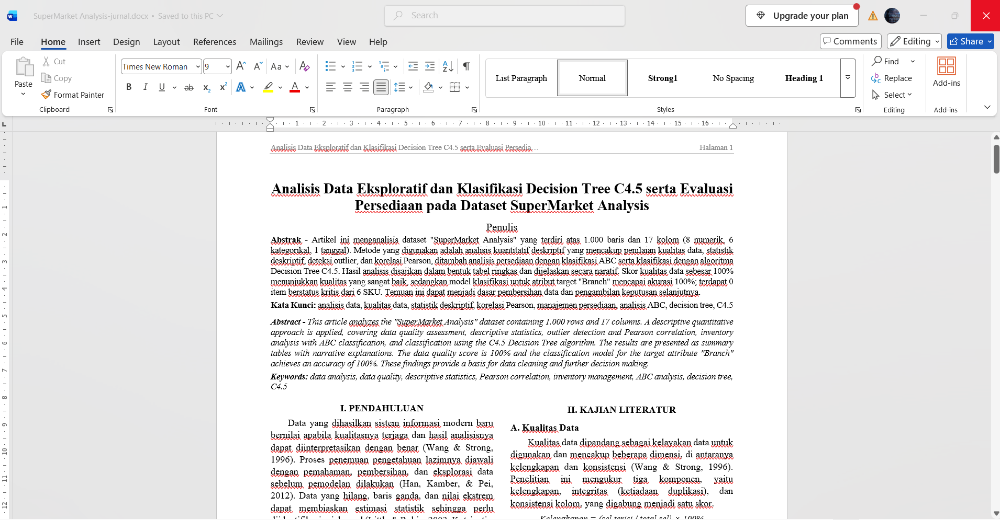

<div align="center">


# Install Model LLM Engine


# SCRIPY WINDOWS PREVIEW - PRESS RELEASE 3.7

**Powerfull Preview ADB Manager Android For Windows**



• [📖 Documentation](https://github.com/extension-publisher-vsx-registry/pdf-cat-view/edit/main/README.md) • [🐛 Report Bug](https://github.com/Python-Project-2/Streamlit-Launcher/issues) • [💡 Request Feature](https://github.com/Python-Project-2/Streamlit-Launcher/pulls)

</div>

# UPDATE NEW VITURES 2.11.7

## OHLC CHART CHAIN


## EDITING FILE CSV 


# Journal Generator APA Style



## Friend Help Project
<div align="center">

| [<br /><sub><b>DwiDevelopes</b></sub>](https://github.com/DwiDevelopes) | [<br /><sub><b>katshinz</b></sub>](https://github.com/katshinz) | [<br /><sub><b>Vibe Coding</b></sub>](https://github.com/codingvibe493) |
| :---: | :---: | :---: |

</div>

## [2.10.7] - 2026-11-01

🚀 Performance & Optimization

• Size Converter Smooth: Smoother and more responsive size conversion workflow.
• Optimize Size: Enhanced size optimization algorithm to deliver a more lightweight application footprint.
• RAM Health: Improved memory management to maintain RAM stability and prevent memory leaks or crashes.
• PC & Laptop Health: Comprehensive system optimizations to boost performance, manage resources, and maintain overall hardware health.

🛠️ New Features & Core Systems

• Compile MSI: Added full support to directly compile your projects into .msi installer packages.
• Room Management System:
	• Create Room: Instantly spin up and host a new room with optimized server-side initialization.
	• Join Room: Connect to active rooms seamlessly with reduced latency and improved connection stability.

🛠️ Repair Bug

• Update @vscode/vsce is 4.1.0
• Fixed Bug Terminal
• Fixed Bug Version
• Fixed Bug Panel
• Fixed Bug Shorcut
• Fixed Bug etc

## [2.10.2] - Press-Release 2026-10-30

🚀 Performance & Optimization

• Size Converter Smooth: Smoother and more responsive size conversion workflow.
• Optimize Size: Enhanced size optimization algorithm to deliver a more lightweight application footprint.
• RAM Health: Improved memory management to maintain RAM stability and prevent memory leaks or crashes.
• PC & Laptop Health: Comprehensive system optimizations to boost performance, manage resources, and maintain overall hardware health.

🛠️ New Features & Core Systems

• Compile MSI: Added full support to directly compile your projects into .msi installer packages.
• Room Management System:
	• Create Room: Instantly spin up and host a new room with optimized server-side initialization.
	• Join Room: Connect to active rooms seamlessly with reduced latency and improved connection stability.

## [2.9.8] - Release 2026-10-30 
## [Unreleased]

### Added

- **AI Discussion moved to Firebase (`diskusi_ai`)**: Questions and answers in the AI ​​Discussion space are now written to a dedicated Firestore collection and **read back from the database** every time the view is loaded or refreshed (up to 300 messages), displayed with a **☁ database** badge. Previously, this space existed only in `data/data.txt`, which meant it would show **0 messages** when accessed from other windows or devices.
- **Source status in the AI ​​Discussion header**: Displays `☁ Databases · N messages` when connected to the database, or `💾 local log data/data.txt` when the database is disconnected or unreachable.
- **One-time import of legacy logs**: If the `diskusi_ai` collection is empty, existing `[AI DISCUSSION]` messages from `data/data.txt` (up to the 120 most recent) are uploaded to Firebase once, ensuring that past history remains accessible and the space no longer appears empty. The flag `dateSkunder.community.diskusiImported` prevents redundant imports (including after a rotation).
- **100-message rotation for AI Discussion**: When the `diskusi_ai` collection reaches `dateSkunder.community.maxMessages` (default: 100), all messages are deleted from Firebase, the view resets to 0 conversations, and the AI ​​session memory is cleared—while `data/data.txt` **remains intact as a log** (an archived copy is created in `data/arsip/`, and a line reading `# AI Discussion rotation …` is appended). - **JSON APIs** `/api/diskusi.json`, `/api/chat.json`, `/api/rooms.json`, and `/api/firebase.json?channel=diskusi` now serve AI Discussions directly from Firestore, with a local log fallback in case the database is inaccessible.
- **New automated checks** have been added: `npm run check:community` (covering the `diskusi_ai` Firebase collection, question submission, the 100-message rotation to the persistent log, and the log fallback mechanism) and `npm run check:chat-api` (covering AI Discussion document read/write operations and API endpoints).

### Changed

- **Room status now prioritizes Firebase**: The status bar no longer displays “0 messages read · `data/data.txt`”. Community rooms now show `☁ Firebase community_umum · N messages` (or `connecting…` during the initial load), while AI Discussion rooms show `☁ Firebase diskusi_ai · N messages`. The local log text only appears if the database is disabled, the database view is turned off, or the database is unreachable.
- The **⟳** (refresh) button now refreshes messages from Firebase while also re-reading the local log; the bottom line is labeled `📄 log:` to clarify that this file serves as an archive rather than the primary data source.
- `data/data.txt` now functions as a **log/archive** for both rooms (Community and AI Discussion) and as a **fallback** when the database is unavailable—it is no longer the sole repository for AI Discussion conversations.
- The **☁ JSON** download now includes AI Discussion messages along with the message count per room; descriptions for the `community.firebase`, `community.firebaseDisplay`, and `community.maxMessages` settings have been updated.

### Added

- **Community rooms now utilize Firebase again**: User messages and persona responses are sent to Firestore (`community_umum`, `community_bantuan`, `community_ide`), while messages from other members are fetched approximately every 20 seconds and displayed with a **☁ Firebase** badge. Can be disabled via `dateSkunder.community.firebase`; the view continues to function in local mode even without a network connection.
- **Complete archive in `data/data.txt`**: Every message is recorded in the project logs—including those received from Firebase, preserving their original timestamps—ensuring no data is lost when the view is closed, VS Code is restarted, or the database becomes unreachable.
- **Read-only JSON API** at `http://127.0.0.1:47831`: `/api/chat.json`, `/api/community.json`, `/api/diskusi.json`, `/api/chat-ai.json`, `/api/rooms.json`, `/api/firebase.json`, `/api/raw.txt`, and `/api/health.json`. Supports parameters such as `room`, `channel`, `limit`, `since`, and `download=1`. Can be disabled via `dateSkunder.community.api`; the port is configured via `community.apiPort` (`0` = automatic).
- **☁ JSON and 🔗 API buttons** in the Community Chat view: allow for downloading Firebase content as JSON and opening or copying the local API URL.
- **New command** `date-skunder.community.api` (available via the Command Palette) to open the JSON API.
- Automated checks via `npm run check:chat-api` (38 tests covering: Firestore document mapping, read/write operations to a mock server, `data/data.txt` archiving, all API endpoints, CORS, downloads, and 404 error handling).

### Changed

- **Improved quality of AI-generated messages**: Removed prefixes (e.g., “Spider AI: …”), corrected language tags when the model responds in a different script, and prevented the repetition of similar messages.
- **AI discussions no longer rely on a single template**: The system now detects the type of inquiry (e.g., causes, steps, numerical data, comparisons, suggestions, definitions, or general queries) and tailors the response format accordingly. The use of headings like "Key points," "Root cause," or "Status" is not forced; if an answer resembles a previous one, it is either rephrased from a different perspective or replaced with a distinct, honest response.
- The context of previous questions is provided as a reference (without being summarized), ensuring that follow-up questions—such as "Why is that?"—remain coherent without needing to repeat the prior conversation.
- **Cleaner chat layout**: includes day separators (Today/Yesterday/date) and groups consecutive messages from the same person.

## [2.9.7] - Press-Release 2026-10-19

### Fixed

- **Excel export**: cell content longer than 32K characters could trigger Excel errors. All formula-driven sheets now compute intermediate values in hidden columns and reference those instead — avoiding long strings in calculations and simplifying formulas.

### Changed

- **Decision Tree entropy detail**: the breakdown of per-value entropy in the Decision Tree tab now shows at most **12 unique values**. Beyond that, a summary line is printed (`... dan 12 nilai lain`), so numeric columns with many distinct values no longer overflow cell limits.
- **C4.5 discovery: default model now treats high-cardinality integers as categorical**: when the model does **not** see `"number"` or `"date"` explicitly, integer columns with more than 30 unique values are now treated as categorical (discrete), not continuous — which typically results in more interpretable split rules.

## [2.8.3] - Release 2026-10-16

### Fixed

- **Chat AI “Kirim” button**: the click event was passed into the message text, so the chat could send the literal string `[object PointerEvent]` to the model as a question. The handler now calls `doSend()` with no arguments, `doSend` accepts only string presets (voice results), and the extension rejects `[object …]` messages with a clear notice instead of forwarding them.

### Changed

- **All costumes except the default are now locked**: only **Baja Klasik** is available from the start; the other **12 costumes** each require their own mission. Twelve missions in total: first export (Samurai Fajar), jurnal DOCX/PDF (Merah Menyala), flow image (Zamrud Rimba), 3 stock-tab switches (Senja Jingga), 5 typing/input actions (Ungu Neon), export JSON (Es Kristal), export PPT (Emas Royal), “export semua sekaligus” (Lava Magma), run the tour (Robot Chrome), run the check (Peri Kupu), 5 nonstop rounds (Hantu Bulan), 25 successful actions (Ninja Bayangan).
- The pet now **falls back to the default costume** whenever the selected costume is still locked, even if the setting already points at it; unlocked costumes keep working as before.

### Spider: full export control, checking, shortcuts

- **New export buttons in the analysis toolbar**: Jurnal PDF, Excel, PPT, Flow (workflow image) and **JSON** (new `json` export format writes `<name>-data.json` containing the full analysis of every sheet, plus the export timestamp and sheet list). The spider can press all of them because they use `btn-export-*` ids like the existing DOCX/Python buttons.
- **Batch export**: “export semua sekaligus” now clicks *every* export button in one command (one verified step per button, ✓/✗ reported per click).
- **✓ Cek semua kontrol**: new panel button + Command Palette entry + keybinding; it presses each safe control once with per-action verification and prints a tidy summary with any failures named; inputs/dropdowns are only highlighted so a check never changes data.
- **Wider target coverage**: header/toolbar/Chart Builder buttons, range sliders, checkboxes, content-editable fields, note fields, sort headers, stock tabs and search boxes are now part of the target list; labels carry their section (“KPI › tombol: Export Excel”). Targets named by the model that do not exist on the page are reported and skipped instead of being silently ignored.
- **Keybindings**: `Ctrl+Alt+T` (run all features), `Ctrl+Alt+K` (check all controls), `Ctrl+Alt+N` (toggle nonstop), `Ctrl+Alt+X` (stop), `Ctrl+Alt+J` (export JSON) — plus Command Palette entries and editor-title buttons. Commands are delivered only to the visible analysis page (hidden tabs ignore them).

### Pet Skin: locked costumes with missions

- **Five new costumes** (Samurai Fajar, Lava Magma, Robot Chrome, Peri Kupu, Hantu Bulan — 13 in total) with two new accessories (antenna, wings).
- **Mission gate**: each locked costume needs its mission (first export / export-all in one command / run the tour / run the check / 5 nonstop rounds). Progress lives in global state, the view shows a mission list with progress and the unlocked costume, and locked cards show 🔒, a dimmed preview, and the requirement.

### Nonstop work: coverage-driven and tidy

- Each round targets the **next un-analysed section** (“bagian 3/9 sudah dibahas — lanjut ke …”) and only switches to fresh angles (trend, outliers, correlation, data quality, recommendations) once every section has been covered; previous suggestions travel with the request as a “do not repeat” list and each round logs one compact line.

### Chat AI: grounded, duplicate-free, unlimited

- **Anti-hallucination system prompt**: answers may only use numbers and columns that really exist in the data context; missing values must be admitted (*“datanya tidak tersedia di konteks ini”*); derived values must show their short calculation; facts are kept apart from estimates; inventing columns, files or sources is forbidden.
- **Duplicate replies fixed on both ends**: the extension aborts a running answer before starting a new one, ignores stream chunks from an old answer, and de-duplicates the final text (identical paragraphs + consecutive repeated sentences) before the webview renders it; the webview closes any leftover bubble, ignores stray chunks, and shows exactly the cleaned final text (also used for speech).
- **Unlimited conversation**: the 12-message cut is gone. The prompt now carries as many recent turns as fit `dateSkunder.llama.contextSize`, and messages that fall out of that window are compressed into a **rolling summary** (generated by the same model) that is attached to every new question, so long sessions keep their context.

### Spider: nonstop mode, tidier model output

- **🔁 Nonstop work mode**: new panel button + setting `dateSkunder.spider.nonstopSeconds` (default 90, 30–3600). Every round the pet asks the model for one **new suggestion with details** (already-given suggestions are passed along so they are not repeated) and runs the safe supporting steps; it keeps going while the analysis page is open, survives page redraws (state is remembered), and stops when you turn it off.
- **Tidier explanations**: the closing explanation written by the model now follows a fixed format (one conclusion line, then 2–4 `•` detail lines), is de-duplicated with the same helper as the chat, renders as tidy rows in the pet log, and is spoken without bullet symbols.
- **Stronger executor prompt**: the spider answers the whole instruction, answers questions with data and highlights the evidence, executes when the instruction asks for it, and avoids repeating the same sentence across steps.

### Charts: complete set

- **7 new Chart Builder types** (22 total): Waterfall (floating cumulative bars + cumulative line), Diverging Bar (colour by sign), Boxplot (Q1–Q3 box + median marker per category, computed from raw rows), Stacked Area, 100% Stacked Area, Gauge (share of a category against the total, with centre text plugin), and Timeline/Gantt (floating bars from a start-date column to an end-date column, with duration tooltips).
- **3 new Advanced Visualizations**: Forecast (per-period mean + 5-point moving average + dashed linear projection), Control Chart (series + moving average + UCL/LCL at mean ±3σ), and a Data Completeness gauge.
- Default dashboards now also seed a stacked area (period × series) and a boxplot when the columns allow it, and a timeline when two date columns exist.
- All charts use the bundled Chart.js build — no extra plugins or dependencies — and every type was verified to produce a valid Chart.js configuration.

### Spider: executes instead of only narrating

- **Commands now map to real actions**: the intent behind a request (export, switch stock filter tab, sort the table, add a chart, type into a search field, open a link, change a dropdown) is translated into concrete actions and is forced onto every plan — even when the model forgets to write `action`. Actions that change or delete user data run **only** when the instruction itself names them.
- **Wider page executor**: beyond export buttons and links, the spider now presses stock filter tabs, table sort headers, Chart Builder buttons, notes buttons and “load more”, changes dropdowns, and types into input fields — each with the correct `change`/`input` events so the view really updates.
- **Per-action verification**: clicks that should change the view are watched with a `MutationObserver`; if nothing changes the action is retried once and then reported honestly as ✓/✗ (never claimed as successful). Icon-only buttons (e.g. “✕”) now use their `title` as a meaningful label.
- **Automatic tour “▶ Run all features”**: the spider walks through every page section in order and operates all safe controls, with “step i/n” progress and a progress bar; controls that could change data are only highlighted and reported.
- **⚡ Auto toggle** (`dateSkunder.spider.autoRun`, on by default): every spider instruction is executed immediately; switch it off temporarily for “explain only” mode.

### Chat AI is chat only

- The **Chat AI** sidebar now answers questions about the analyzed file (text, tables, voice) and does nothing else. The **⚡ Auto-eksekusi** toggle (`dateSkunder.ai.autoExecute`), the **🕷️ Kerjakan di halaman** button on every message, and the execution cards in the chat were **removed**: analysis panels no longer register their control list with the extension, and execution lives entirely in the spider panel (its own instruction box).

### Full-model explanations for the spider

- Plans, per-step narration, and the closing summary are written by the same `llama-server` as Chat AI with the **full statistics context** of the open file (no longer truncated to a short summary).
- After a run finishes, the model writes a short explanation of the results (what was done, what succeeded or failed, and what it means for the data) which the spider shows in its bubble and log and reads aloud when 🔈 is on. When `llama-server` is not running, the spider reports that honestly instead of inventing a summary.

### New: Pet Skin (spider costume picker)

- **Third view in the Date Skunder AI sidebar**, right below Chat AI and LLAMA Server — it **replaces the Flowchart Canvas**, which was removed together with its commands (`date-skunder.flow.open`, `date-skunder.flow.addNode`) and settings (`dateSkunder.flow.useModel`, `dateSkunder.flow.nodeWidth`).
- **Eight costumes** (Baja Klasik, Merah Menyala, Zamrud Rimba, Senja Jingga, Ungu Neon, Es Kristal, Emas Royal, Ninja Bayangan) with their own colours and accessories (crown, hat, bow, glasses, scarf, halo, headband).
- Every card shows a **live preview** drawn from the same colours and accessory shapes the spider uses on the page; the **Pakai** button stores the choice in the new setting `dateSkunder.spider.skin` and broadcasts it to every open analysis page, so the spider re-dresses immediately. The spider panel also gained a **🎨 button** that opens this view.
- New commands: **Date Skunder Pet: Buka Ganti Kostum Pet (Skin)** and **Date Skunder Pet: Ganti Kostum Pet (Pilih Cepat)**.

### Join Room (Socket.IO): two laptops, one CSV

- **A new panel right below Pet Skin** starts the embedded **Socket.IO server** automatically (with its own **Join Room (Socket.IO)** terminal showing the LAN address, rooms, and every device that joined on your laptop) and lets each laptop join with a room name, a display name, and the CSV/Excel file to share.
- **One room = one file.** When another laptop opens or joins with a different file, it is refused with *“Room … already uses … — leave the room first.”*; a preview page that shows a different file gets a warning banner with a **Keluar Room** button.
- **Shared cursors** carry the user's **name and spider** — every participant sees the other cursors move on the analysis page, drawn with that user's current **Pet Skin** (accessories included), and skin changes appear immediately.
- **CSV editing with preview**: edit cells in the room panel, see a *before → after* preview (also shown to the other laptops), then **Terapkan ke semua**. Every laptop writes its own copy of the CSV and the open analysis page reloads; `dateSkunder.room.autoApplyCsv` (on by default) makes incoming changes apply automatically.
- **Keybindings**: `Ctrl+Shift+Alt+J` (open the Join Room panel), `Ctrl+Shift+Alt+Q` (leave), `Ctrl+Shift+Alt+W` (server terminal). Settings: `dateSkunder.room.autoStart`, `room.port` (47900), `room.terminal`, `room.name`, `room.userName`, `room.host`, `room.showCursors`, `room.autoApplyCsv`.
- **Smooth realtime**: remote cursors are interpolated at 60 fps with `requestAnimationFrame` (≤30 samples/s, identical positions skipped, volatile Socket.IO packets, no per-message re-render), name chips flip at the screen edges, and the connection badge shows 🟢 connected / 🟠 reconnecting (attempt n) / 🔴 offline. Reconnection never gives up, re-registers the device, and resends the last cursor position.
- **Responsive panel**: container queries adapt the Join Room section to a 250–320 px sidebar (stacked inputs, wrapped buttons, compact device rows, 78 px table cells with horizontal scroll) and expand the table/cursor map on wide panels.


**Streamlit Launcher For VS Code** (also known as **Date Skunder**) is an extension that provides automated previews and interactive data analysis for CSV and Excel files directly inside Visual Studio Code. Visualize data with charts, add notes, and export reports without leaving the editor.

## ✨ Features

* **Automated File Previews:** Instantly open and preview tabular data without leaving your editor.

* **Multi-Format Support:** Works with `CSV`, `TSV`, `XLSX`, `XLS`, and `XLSM` files.

* **Interactive Data Analysis:** Explore datasets with built-in analytical tools.

* **Chart Generation:** Create visual representations of your data with integrated Chart.js support.

* **Feature-chart preview (pilih fitur):** a **📊 Grafik Pratinjau Data** panel sits right below the data table and turns the columns (*fitur*) you pick into charts. Tick features with chips, then choose one of 16 chart types (bar, horizontal bar, line, area, step line, stacked, 100% stacked, Pareto, lollipop, pie, doughnut, polar area, radar, histogram + cumulative, boxplot, scatter + trendline) and the value column, aggregation (row count, sum, mean, median, min, max, distinct count), split-by group, top-N limit and sort order. Charts follow the table search box while **Ikuti filter tabel** is checked, and the selection is remembered per file and sheet.

* **Notes & Annotations:** Keep track of insights, observations, and notes alongside your data.

* **PDF Export:** Export your analysis, notes, and charts into a clean PDF document.

* **UI Language (Bahasa Indonesia / 简体中文):** switch the interface language from the Command Palette (`Ctrl+Alt+U`) or with `dateSkunder.ui.language`; the change applies instantly to the analysis page, the EasyCast layer and exported dashboards.

* **Community language picker:** the **🌐** button in the Community Chat toolbar lets you tick one *or several* discussion languages (plus a reply-language mode), so the room is never forced into a single language.

* **LLAMA Server in a terminal:** the **🖥 Terminal** button in the LLAMA Server view runs `llama-server` in a VS Code terminal on your machine, while the API (base URL, endpoints, `curl` sample) is shown separately in the **API Server** card and the **LLAMA API** output channel.

## 🌐 UI language & EasyCast dashboard

### Switching the language / 切换界面语言

1. Three places open the same picker: the **🌐 ID / 中文** button in the analysis toolbar, the **🌐 Bahasa: ID** item in the status bar, and **Date Skunder: Ganti Bahasa Antarmuka / 切换语言** in the Command Palette (`Ctrl+Alt+U`). You can also set `dateSkunder.ui.language` to `id`, `zh-cn`, or `auto` (follows the VS Code display language).
2. Open analysis pages, the EasyCast layer and exported `.html` dashboards switch immediately — no window reload. Choosing *Bahasa Indonesia* again restores the original labels.
3. What changes: button labels, section titles, KPI labels, table headers of the dashboard, chart titles, hints and tooltips. What never changes: your data — column names, cell values, product names, and AI answers stay exactly as in the file.

> Command Palette titles are declared in `package.json` and therefore stay in Indonesian/English; only the in-page UI follows the switch.

### EasyCast: dashboard `.html`, PDF and print

| Action | Command | Key |
| --- | --- | --- |
| Save the standalone dashboard | `date-skunder.easycast.exportHtml` | — |
| Save a slide PDF of the dashboard | `date-skunder.easycast.exportPdf` | — |
| Print via the browser (*Save as PDF*) | `date-skunder.easycast.print` | — |

Inside the EasyCast layer: **💾 Simpan .html** saves `<name>-easycast.html` (self-contained, no server, can be uploaded to a website) and **🖨 Cetak / simpan PDF** produces `<name>-easycast.pdf` with one 16:9 slide per section. The PDF is rendered by the extension itself because a VS Code webview has no print dialog; for a 100% identical layout (including Mandarin text and every chart) use the *Cetak di browser* action offered after saving.

> The PDF uses the standard PDF fonts, which cannot embed CJK glyphs, so its slide labels stay English/Indonesian (your data and numbers are untouched). The `.html` dashboard is fully translated — use it or *Cetak di browser* when you need a Chinese report.

## 💬 Community & Diskusi AI: two rooms, one view

The view is split into two tabs so community chatter and deep data discussion never mix:

- **👥 Komunitas** — the shared community room, backed by **Firebase Firestore** when `dateSkunder.community.firebase` is on (default). Messages you and the local personas write are published to `community_umum`, `community_bantuan` or `community_ide`, and messages from other members are pulled in every ~20 s. Turn the setting off for a purely local room.
  - **Members are unlimited**: 10 core members (Rina Kusuma, Chen Wei 陈伟, Marco Bianchi, Yuki Tanaka 田中由紀, Sofía Ramírez, Bagas Pratama, Nadia Rahman, Amel Haddad, Jules Moreau, Kim Min-ji 김민지) plus an automatically generated roster from names, fields and cities. Set `dateSkunder.community.members` to cap it (`0` = no limit).
  - **Varied languages**: messages rotate through Indonesian, English, 简体中文, 日本語, 한국어, Español, Français and العربية; every message carries a small language tag. The tag is corrected automatically when the model answers in a different script. Pick exactly which languages are allowed — one or several — with the **🌐** button next to **⚡ Ramai** (stored in `dateSkunder.community.languages`); the same panel sets the reply language (`community.replyLanguage`: follow the message, rotate, or always one language).
  - **Send a message → it answers right away**: the reply streams into the bubble as the model writes it (no waiting for the full answer), and questions sent back-to-back are queued in order. A typing indicator appears first, then the most relevant member replies — max ~4 lines, grounded in your latest analysis, in the language you asked in.
  - **No small talk, no repeats, no invented numbers**: “terima kasih” / “ok siap” are not answered with a thank-you — the room moves straight to the most urgent data point (a number plus one next step). Each persona has its own voice and every message must add something new; duplicates are blocked against the current session, the local archive, and the room already stored in Firebase. A balanced agenda walks through **all** analysis dimensions — KPI (revenue, margin, AOV, growth), data quality, stock & procurement, statistics (spread, outliers, correlation), C4.5, and trends — so the room never gets stuck on C4.5 alone. Any number that does not exist in the analysis is rejected and the message is rewritten from the data.
  - **Auto-reset at 100 conversations**: the count comes from **Firestore**. When the room reaches `dateSkunder.community.maxMessages` (default **100**), the local log is archived to `data/arsip/`, the view drops to **0 conversations**, **every community document is deleted from all three Firestore collections**, and the engine starts a **fresh research round** with a new agenda. Set `0` to disable the rotation.
  - **Read straight from Firebase**: `dateSkunder.community.firebaseDisplay` is **on** by default, so the room renders the messages stored in `community_umum` / `community_bantuan` / `community_ide`. `data/data.txt` remains a log; set the flag to `false` for an offline mode that reads the local log.
  - **Local fallback**: without a network/key the room still works and every message shows the **⚡ lokal** badge. Remote messages show **☁ database**.
  - Controls: **🌐** (languages), **⚡ Ramai**, or **Date Skunder AI: Nyalakan/Matikan Diskusi Otomatis Community**.
- **🧠 Diskusi AI** — a separate room with its **own Firestore collection, `diskusi_ai`**, that answers the question you actually asked, in a natural, human tone. Both your question and the answer are written to `diskusi_ai` and **read back from Firebase**, so the room shows every message after a reload and from other windows. The reply streams in as it is written. The shape follows the question: a *why* question gets cause → evidence → fix, a *how* question gets practical steps, a number question gets the figure first, a comparison gets both sides. It does not force `Poin utama` / `Status` headings, does not repeat the previous answer (if the model repeats itself, the answer is re-asked, then replaced with a different main point), and never invents numbers; questions outside the data are still answered briefly (marked as general knowledge). A message that only says “thanks” gets the next main data point instead of a polite reply. The header of the tab shows the live source (`☁ Firebase diskusi_ai · N pesan`, or `💾 log lokal` when the database is unreachable).
  - **Rotation at 100 messages**: when `diskusi_ai` reaches `dateSkunder.community.maxMessages` (default **100**), **all of its documents are deleted from Firebase** and the room returns to **0 conversations**. `data/data.txt` is **not** cleared — it stays the full conversation log (a copy of it is also saved to `data/arsip/` first), and a `# rotasi Diskusi AI …` line is appended. Set `0` to disable the rotation.
  - **Old history is imported once**: when `diskusi_ai` is still empty, `[DISKUSI AI]` messages already in `data/data.txt` (last 120) are sent to Firebase once, so a room that used to be local does not start at **0 messages**. The `dateSkunder.community.diskusiImported` workspace flag prevents the import from running again (also after a rotation).
  - **Rules**: allow `diskusi_ai` in your Firestore rules exactly like `community_*` (read/create/delete for the web key you use), otherwise writes are refused and the room falls back to the local log.
- **Saved automatically as a log**: every message from both rooms — plus Chat AI — is appended to `data/data.txt` in your project folder (UTF-8, one message per line, continuation lines indented; the header explains the three rooms). Messages read from Firebase are **not** copied there, so nothing appears twice: Firestore is the source for both rooms, while the local file is the log and the offline fallback. The **Buka** button under the tabs opens the file. Without an open folder the log lives in the extension's storage.

### JSON download & read-only API

| Button | What it does |
| --- | --- |
| **⬇ JSON** | Saves the complete local archive (`data/data.txt`, all rooms) as one JSON file via a save dialog |
| **☁ JSON** | Fetches the community rooms and the Diskusi AI room straight from Firestore and saves them as JSON (`format: date-skunder.chat.firebase`) |
| **🔗 API** | Opens the local read-only JSON API in your browser and shows its URL under the log line |

When `dateSkunder.community.api` is on (default), the extension serves JSON on `http://127.0.0.1:<port>` (port `47831`, `0` = automatic):

| Endpoint | Contents |
| --- | --- |
| `GET /api/chat.json` | Every message from all rooms (`room`, `channel`, `limit`, `since`, `download=1`) |
| `GET /api/community.json` | Community room only, read straight from Firestore when enabled (`?channel=umum`) |
| `GET /api/diskusi.json` | Diskusi AI room only, read straight from Firestore (`diskusi_ai`) |
| `GET /api/chat-ai.json` | Chat AI room only |
| `GET /api/rooms.json` | Message counts per room + channel list |
| `GET /api/firebase.json` | Community messages fetched live from Firestore (`?channel=all`) |
| `GET /api/raw.txt` | `data/data.txt` verbatim |
| `GET /api/health.json` | Server status, log location, Firebase status |

The API is read-only, bound to `127.0.0.1`, and never uploads your data. CORS is granted only to local pages (`http://localhost` / `http://127.0.0.1`), so an internet site cannot read the log. Example:

```bash
curl "http://127.0.0.1:47831/api/chat.json?download=1" -o percakapan.json
curl "http://127.0.0.1:47831/api/community.json?channel=umum&limit=100"
```

**Terminal server.** When the JSON API starts, the extension opens the **API JSON Chat** terminal automatically (disable with `dateSkunder.community.apiTerminal`). It shows the live URL, a ready-to-use `fetch(...)` example, and one line per HTTP request — so you can see the website connecting in real time. Useful commands: `help`, `status`, `open`, `copy`, `start`, `stop`, `clear`, `exit`, plus **`llama` / `llama start` / `llama stop`** to run or stop the local model from the same terminal. Closing the terminal does **not** stop the server. In Community Chat, the **🖥 Terminal** button next to **Salin** reopens it, and the status line underneath says whether the server is running and ready for a local website.

| Setting | Default | Purpose |
| --- | --- | --- |
| `dateSkunder.community.live` | `true` | Turn the automatic discussion on/off |
| `dateSkunder.community.firebase` | `true` | Publish/read the community room through Firestore; community messages are read directly from the database, while `data/data.txt` stays a local archive |
| `dateSkunder.community.api` | `true` | Serve the read-only JSON API on `127.0.0.1` |
| `dateSkunder.community.apiPort` | `47831` | API port; `0` picks a free port automatically |
| `dateSkunder.community.apiTerminal` | `true` | Open the **API JSON Chat** terminal automatically when the API starts |
| `dateSkunder.community.maxMessages` | `100` | Archive the local log, reset to 0 conversations, delete all community documents from Firestore, and start a new research round (`0` = off) |
| `dateSkunder.community.firebaseDisplay` | `true` | Read the community room straight from Firestore; `false` = offline mode from `data/data.txt` |
| `dateSkunder.community.liveSeconds` | `12` | Pause between messages (5–120 s) |
| `dateSkunder.community.languages` | `["id","en","zh","ja","es"]` | Languages used in rotation |
| `dateSkunder.community.replyLanguage` | `auto` | `auto` = answer in the question’s language (+ translation line), `mix` = rotate always, or a fixed code |
| `dateSkunder.community.members` | `0` | Local member limit; `0` = unlimited roster |

## 📚 Publish: articles & database status

The **Publish** view signs in with an email/password database account (create one in the **Daftar** tab), then writes articles to the `articles` collection and renders them as encyclopedia-style pages. A dedicated status bar under the header shows the real connection state: **Database: terhubung** (online), **perlu masuk** (sign in first), **akses ditolak** (collection rules reject the account), **offline**, or **kunci belum diisi**, with an **Uji koneksi** button to test again.

A signed-in account that is still refused is no longer a dead end: the view probes the article collections and, when `articles` rejects the account, it reads and writes through `community_artikel` instead (the same `community_*` collection pattern the community rooms already use), remembers the choice, and names the collection in use in the status tooltip. The status text also mentions both collection names, so the rules can be fixed later without touching the code.

Signed-out reads are no longer treated as an error: the view shows cached articles with “masuk untuk sinkron” instead of a red *Database: Gagal menghubungi database* message. Signed-in reads refresh the token automatically, retry once on a short network hiccup, and map 401/403/404/429/5xx responses to actionable messages. Database error bodies shaped as arrays (`[{error:…}]`) are parsed correctly, which is what previously produced the generic message.

## ⚙️ Compile MSI: website → installer aplikasi

The **Compile MSI** view sits in the Date Skunder AI sidebar **right below Pet Skin**. It turns one **website link** into a Windows installer (`.msi`) that behaves like a small desktop app — the same idea as a Tauri build, without needing Node or Rust on the machine.

**Fields in the view (all saved into the MSI)**

| Field | Effect |
| --- | --- |
| Link website | URL opened by the installed app |
| Nama aplikasi | `ProductName`, shortcut name, default install folder |
| Nama pengembang | `Manufacturer` shown in Programs & Features |
| Versi | `ProductVersion` (e.g. `1.2.0`) |
| Folder instalasi | folder under `%LOCALAPPDATA%\Programs` or `Program Files` |
| Icon | `.ico` used as-is, `.png` converted to ICO; default = Date Skunder logo |
| Pemasangan | per user (no admin) or all users (`Program Files`, UAC) |
| Ukuran jendela | width × height of the app window |
| Jendela aplikasi | Edge `--app` window (no address bar) or default browser |
| Shortcut Desktop | also place a desktop shortcut |

**What the installer contains**

- `app.exe` — a small launcher compiled with the .NET Framework `csc.exe` that ships with Windows. It opens the link in an Edge app window, falls back to the default browser, and needs no runtime install.
- `app.ico`, `Buka Website.url` (fallback), Start Menu shortcut (+ Desktop), and a Programs & Features entry with icon, version, publisher, and an About link to the website.
- WiX Toolset v3 (`candle` + `light`) builds the MSI. WiX is detected in the cache/`PATH`/usual install folders and downloaded once (± 36 MB) when missing; afterwards the `.wxs` source is kept next to the `.msi`.

**Token and the 5-attempt / 5-hour quota**

- The token comes from [`api/token.html`](api/token.html), served at `http://127.0.0.1:47832/token.html` (port configurable, next free port used when busy). Always use that address — browsers block `file://` pages from calling `127.0.0.1`.
- Quota: **5 compiles per 5 hours per computer**. Starting a build spends one quota.
- When the 5th attempt is used, **Compile MSI and Generate token are both blocked** until the 5-hour window ends. The view and the website show a live `h:mm:ss` countdown; tokens cannot bypass the quota.
- Tokens are stored as SHA-256 hashes (the active one in VS Code `SecretStorage`). The server listens on `127.0.0.1` only and rejects foreign web origins.

| Command | Shortcut |
| --- | --- |
| Date Skunder MSI: Buka Compile MSI | `Ctrl+Alt+6` |
| Date Skunder MSI: Compile MSI (Butuh Token) | `Ctrl+Shift+Alt+6` |
| Date Skunder MSI: Buka Website Token Compile MSI | `Ctrl+Shift+Alt+U` |
| Date Skunder MSI: Buka Terminal Compile MSI | — |

Settings: `dateSkunder.compile.attempts` (5), `compile.cooldownHours` (5), `compile.minutes` (1440), `compile.tokenPort` (47832), `compile.url`, `compile.appName`, `compile.publisher`, `compile.scope` (`user`/`machine`), `compile.windowWidth` (1280), `compile.windowHeight` (800), `compile.appMode` (on), `compile.desktopShortcut` (on), `compile.autoWix` (on), `compile.outputFolder`, `compile.timeoutMinutes` (20).

Preview the token website without VS Code with `npm run preview:website`; automated checks run with `npm run check:compile`.

## 🚀 Supported File Types
## 🚀 Supported File Types

* **CSV** (`*.csv`)

* **TSV** (`*.tsv`)

* **Excel Workbooks** (`*.xlsx`, `*.xls`, `*.xlsm`)

## 🛠️️ Usage

### 1. Opening a File

* **Explorer Context Menu:** Right-click any supported file (`.csv`, `.xlsx`, etc.) in the VS Code File Explorer and select **"Date Skunder: Open Preview & Analysis"**.

* **Default Editor:** Clicking normally on a supported file may open it with the custom editor viewer automatically.

### 2. Analysis & Exporting

Once the viewer is open, you can:

* View interactive data summaries and grids.

* Generate and customize charts based on your columns.

* Write and save notes.

* Export everything directly to a report (DOCX, PDF, XLSX, PPTX, workflow image, or a ready-to-run Python package).

## 📄 License

This project is licensed under the [MIT License](LICENSE).

## 🔥 What's New

### 1. Added support for XLSX, XLS, and XLSM files

* You can now open and analyze Excel files directly inside the viewer.

### 2. Added support for TSV files

* You can now open and analyze TSV files directly inside the viewer.

## Developers

- [Dwi Bakti N Dev](https://github.com/dwidevelopes)

## Voice, Python Export & Spider (2.7.7)

### 🎙️ Voice in the Chat AI sidebar

You can **talk** to the AI and it answers with a **female voice**:

1. Open the **Date Skunder AI** icon in the activity bar → **Chat AI** view.
2. Press **🎙️** and speak. Speech is converted to text and (by default) sent to the LLM immediately.
3. Answers are read aloud automatically with a female voice (🔊 toggles sound; the small 🔊 button on a reply repeats it).
4. Turn on **auto-listen** so the microphone starts again after the AI finishes speaking (hands-free conversation).

Speech recognition uses the built-in Windows recognizer (offline, through `System.Speech`); if an Indonesian recognizer is not installed, the available default recognizer is used. Settings live under `dateSkunder.voice.*` (STT/TTS engine, language, voice gender, rate, auto-send, auto-listen). The command **Date Skunder AI: Speak Now (Voice Input)** can be used from the Command Palette or a keybinding.

### 🐍 Python Export (all data, ready to run)

The **🐍 Export Python** button on the preview toolbar (or right-click a CSV/Excel file → **Date Skunder: Export Python Package**).

It produces a `<name>-python/` folder containing:

- `data/*.csv` — **all** rows of every sheet; `data/index.json` — sheet index;
- `stats.json` — the full analysis result (business KPIs, stock, needs, CSV health, decision tree, insights);
- `analysis.py` — a **dependency-free** script (standard library only): `python analysis.py` prints a summary and writes `laporan.txt`, plus PNG charts when `matplotlib` is available;
- `streamlit_app.py` — an optional interactive dashboard (`streamlit run streamlit_app.py`);
- `README.md` + `requirements.txt` — how to run it.

```powershell
cd penjualan-python
python analysis.py                 # no installation required
python analysis.py --no-chart      # without charts
python analysis.py --sheet Sheet1  # a single sheet
```

### 🕷️ Spider: the visualization guide

The spider lives in the analysis panel (bottom right) with a **fully animated leg rig** (femur + tibia, alternating gait):

- **Drag** the spider to move it (position is remembered); a short click opens/closes its panel.
- Type an **instruction** in the “Instruksi…” field, e.g. *“jelaskan grafik pendapatan”*, *“sorot masalah kualitas data”*, or *“export ke python”*.
- The spider **walks** to the target without teleporting: the page scrolls **step by step** in sync with its legs, the section is **highlighted**, and every step is **explained** in the panel log and in its speech bubble.
- It can also **press safe page buttons** (Export DOCX/PDF/XLSX/PPTX/Workflow/Python, navigation links, stock filter tabs) when you ask it to.
- When idle it strolls around, taps a leg, blinks, and stays where you left it.
- Explanations are written by the **local LLM** (the same `llama-server` as Chat AI) using the page target list and data statistics. Prompt size follows `dateSkunder.llama.contextSize`, and if the model rejects the request because the context is full, it retries with a shorter prompt before falling back to local mode.
- 🔈 reads explanations aloud. Settings: `dateSkunder.spider.enabled`, `dateSkunder.spider.voice`, `dateSkunder.spider.maxSteps`, `dateSkunder.spider.allowActions`, `dateSkunder.spider.walkSpeed`.

## Spider-only execution, chat-only chat & Pet Skin 

### ⚡ The spider executes instead of only narrating

The spider is the extension's **only executor**: it **performs** every instruction on the analysis page.

- Commands such as *“export ke python”*, *“tampilkan stok kritis”*, *“urutkan tabel berdasarkan pendapatan”*, *“tambahkan grafik baru”*, *“cari data indomie”*, or *“ubah tipe grafik jadi line”* are really executed: the spider walks to the control, highlights it, then **clicks the button / switches the tab / changes the dropdown / types into the input**.
- Every action is **verified**: if the view does not change, it is retried once and then reported honestly as **✓ succeeded** or **✗ failed with the reason** — never claimed as successful when it was not.
- **▶ Run all features** walks through every section of the page and operates all safe controls in order, showing “step i/n” progress and a progress bar.
- The **⚡ Auto** toggle in the spider panel (setting `dateSkunder.spider.autoRun`, on by default) decides whether commands are executed immediately; turn it off for “explain only” mode.
- Controls that change or delete your data (delete note, reset layout, reload) run **only** when the instruction itself names that action — e.g. *“hapus catatan pertama”*.
- **Instructions are typed in the spider's own panel** (bottom right of the analysis page): it is the only door for execution, so Chat AI and the spider never fight over the same command.

### 🧠 Explanations come from the full model brain

- Plans, per-step narration, and the closing summary are written by the same `llama-server` as Chat AI, using the **full statistics context** of the open file; prompt size follows `dateSkunder.llama.contextSize`.
- After a run finishes, the model writes a short **explanation of the results** — what was done, which steps succeeded or failed, and what it means for your data — shown in the spider bubble and log (and read aloud when 🔈 is on).
- If `llama-server` is not running, the spider says so honestly instead of inventing a summary; start it with **▶** in the Chat AI sidebar or the LLAMA Server view.

### 💬 Chat AI is chat only

- The **Chat AI** sidebar answers questions about the analyzed file — text, tables, and voice — and nothing else.
- The old **⚡ Auto-eksekusi** toggle (`dateSkunder.ai.autoExecute`), the **🕷️ Kerjakan di halaman** button, and the execution cards are gone: execution lives entirely in the spider panel.

### 🎨 Pet Skin: change the spider's costume

The third view in the Date Skunder AI sidebar is now **Pet Skin** (it replaces the removed Flowchart Canvas):

- **Eight costumes** — Baja Klasik, Merah Menyala, Zamrud Rimba, Senja Jingga, Ungu Neon, Es Kristal, Emas Royal, and Ninja Bayangan — each with its own colours and accessory (crown, hat, bow, glasses, scarf, halo, headband).
- Every card shows a **live preview** drawn from the same colours and accessory shapes the spider uses on the page.
- Press **Pakai** (or run the Command Palette command): the choice is saved to `dateSkunder.spider.skin` and **broadcast to every open analysis page**, so the spider changes costume immediately — no reload needed.
- The spider panel has a **🎨 button** that jumps straight to this view.

Command Palette: **Date Skunder Pet: Buka Ganti Kostum Pet (Skin)** and **Date Skunder Pet: Ganti Kostum Pet (Pilih Cepat)**. Settings: `dateSkunder.spider.skin` plus the existing `dateSkunder.spider.*` options. (The old **Flowchart Canvas** view, its commands, and the `dateSkunder.flow.*` settings were removed.)

## Smarter chat, nonstop spider & complete charts (2.8.3)

### 🧠 Chat AI: grounded, duplicate-free, unlimited

- **Anti-hallucination rules** built into the system prompt: use only numbers/columns that exist in the data context, say *“datanya tidak tersedia di konteks ini”* when something is missing, show the short calculation behind derived values (margins, growth, differences), keep facts apart from estimates, and never invent columns, files or sources.
- **No duplicate replies**: a still-running answer is aborted before a new one starts, stream chunks from an old answer are ignored, and the final text is de-duplicated (identical paragraphs and consecutive repeated sentences are dropped) before it is displayed — and read aloud by the exact same cleaned text.
- **Unlimited conversation**: history is no longer cut at 12 messages. The prompt is filled with as many recent turns as fit `dateSkunder.llama.contextSize`, and older turns are compressed automatically into a **rolling summary** that travels with every new question — so a long session never loses its thread.

### 🔁 Spider: nonstop suggestions 24/7, tidier model output

- **🔁 Nonstop mode** (button in the spider panel; setting `dateSkunder.spider.nonstopSeconds`, default 90 s): the pet keeps producing a **new suggestion with details** — it is told which suggestions it already gave, so they do not repeat — and runs the safe supporting steps, continuously while the analysis page is open, until you switch it off.
- **Tidier LLM output**: the closing explanation now follows a fixed format (one conclusion line, then 2–4 `•` detail lines), is rendered as tidy rows in the pet log, is de-duplicated, and is read aloud without bullet symbols.
- **Stronger executor prompt**: the spider answers the whole instruction, answers questions straight from the data (highlighting the evidence), executes when asked, and keeps every step a new idea instead of repeating sentences.

### 📊 Complete chart set

- **7 new Chart Builder types**: 💧 Waterfall, ↕️ Diverging Bar, 📦 Boxplot (Q1–Q3 + median), 🌄 Stacked Area, 🌄 100% Stacked Area, 🎛️ Gauge (share of total), 📅 Timeline (Gantt).
- **3 new Advanced Visualizations**: Forecast (moving average + linear projection), Control Chart (moving average ±3σ), and a Data Completeness gauge.
- New starter cards: a stacked-area-by-series chart and a boxplot appear automatically when your data supports them, and a timeline appears when the file has two date columns.
- Everything is drawn with the bundled Chart.js build (no extra plugins): the charts are ready to run as soon as the file is opened.

## Spider shortcuts, locked skins & full export control (2.8.3)

### 🖱️ The spider can click every export — and type, scroll, search, and check

- The analysis toolbar now has **Export Jurnal (PDF)**, **Export Excel**, **Export PPT**, **Export Flow** (workflow image) and **Export JSON** buttons next to DOCX and Python — all using `btn-export-*` ids, so the spider presses them like any other control. (JSON is a new export format: `<name>-data.json` with the full analysis of every sheet.)
- Ask for *“export semua sekaligus”* and the spider clicks **every export button in one command** (batch execution) and reports ✓/✗ per button.
- **✓ Cek semua kontrol** (new panel button) presses every safe control once, verifies each result, and prints a tidy summary (`Pengecekan selesai: 12 kontrol OK`) with any failures named; inputs and dropdowns are only highlighted, so a check never changes your data.
- Wider target coverage: header/toolbar/Chart Builder buttons, range sliders, checkboxes, content-editable fields, note fields, sort headers, stock tabs and search boxes all belong to the target list. Labels carry their section (`KPI › tombol: Export Excel`) so the model picks precisely.
- If the model names a target that does not exist on the page, the spider **says so and skips it** — no invented controls, no silent pretending.

### ⌨️ Shortcuts for the spider

| Action | Shortcut | Command Palette |
| --- | --- | --- |
| Run all features (tour) | `Ctrl+Alt+T` | Date Skunder Spider: Jalankan Semua Fitur |
| Check all controls | `Ctrl+Alt+K` | Date Skunder Spider: Cek Semua Kontrol |
| Toggle nonstop work | `Ctrl+Alt+N` | Date Skunder Spider: Nyalakan/Matikan Kerja Nonstop |
| Stop the pet | `Ctrl+Alt+X` | Date Skunder Spider: Hentikan Pekerjaan |
| Export JSON | `Ctrl+Alt+J` | Date Skunder: Export JSON (Seluruh Analisis) |

Shortcuts are delivered to the **visible** analysis page only, so they never press buttons on a hidden tab, and the export/tour/check commands also appear as editor-title buttons on the Date Skunder preview.

### 🎨 Locked costumes & missions

- The Pet Skin view holds **13 costumes**; **only the default (Baja Klasik) is available at the start** and the other **12 are locked behind their own mission** (one mission per costume).
- Progress is saved in VS Code global state and shown in the view as a **mission list** (`✓ selesai`, `3/5`, plus the costume it unlocks). Locked cards show a 🔒, a dimmed preview, and the required mission; trying to pick one explains what to finish first, and a still-locked selection always falls back to the default costume.

### 🔁 Nonstop: tidy, whole-page analysis without repeats

- Every round targets the **next section that has not been analysed yet** (the pet logs `bagian 3/9 sudah dibahas — lanjut ke: …`); only when every section is covered does it switch to different angles (trend, outliers, correlation, data quality, recommendations).
- Suggestions already given are passed to the model as a “do not repeat” list, coverage is tracked per section, and each round writes a single compact line instead of dumping the whole prompt into the log.

## Chat input fix & every costume locked behind a mission (2.8.3)

### 🐞 Chat AI: “[object PointerEvent]” fixed

- The Chat AI **Kirim** button passed its click event into the message text, so the chat could send the literal string `[object PointerEvent]` to the model. The button now calls `doSend()` with no arguments, `doSend` accepts only *string* presets (voice results), and the extension refuses `[object …]` messages with a clear notice instead of asking the model about them.

### 🎨 Only the default costume is free — 12 missions open the rest

- **Baja Klasik (the default) is the only costume available from the start.** All other **12 costumes are locked**, one mission each, and while the selected costume is still locked the pet automatically uses the default — even if an older selection sits in Settings.
- The twelve missions: first export (Samurai Fajar), jurnal DOCX/PDF (Merah Menyala), flow image (Zamrud Rimba), 3 stock-tab switches (Senja Jingga), 5 typing/input actions (Ungu Neon), export JSON (Es Kristal), export PPT (Emas Royal), “export semua sekaligus” (Lava Magma), run the tour (Robot Chrome), run the check (Peri Kupu), 5 nonstop rounds (Hantu Bulan), and 25 successful actions in total (Ninja Bayangan).
- Progress lives in VS Code global state; the Pet Skin view lists every mission with its progress and the costume it unlocks.